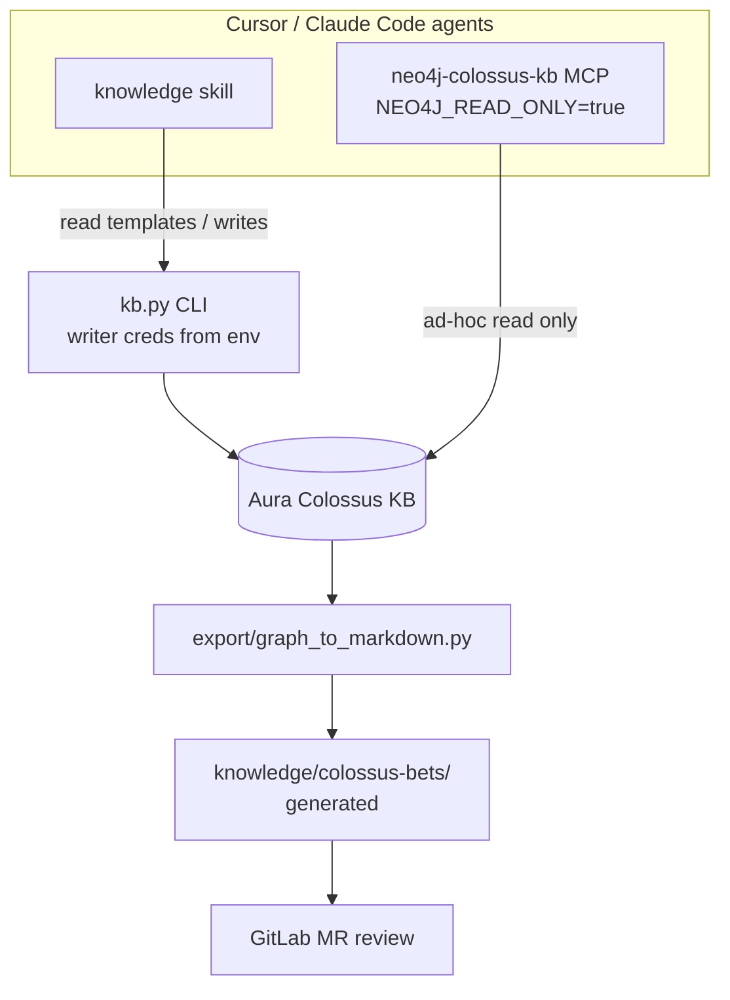

# Colossus company knowledge base (work item [#846](https://gitlab.colossusbets.com/groups/colossus/-/work_items/846))

**Revised 2026-10-06** after review against the repo. Changes from the previous draft are summarised at the end.

## Goal and constraints

| Topic | Decision |
|-------|----------|
| Scope | **Colossus Bets only** (no WSD/mmmapper) |
| **Source of truth** | **Neo4j Aura.** Built and tested on a dedicated **Aura Professional staging instance** (`839b9d82`, database `neo4j`), then migrated into the team's **existing Aura Professional instance** (`fc801360`, database `neo4j`), where it shares the database with other graphs (decided and staging added 2026-10-07). See *Environments* |
| Git role | `agent-capabilities` ships schema, migrations, the `kb` CLI, ingest/export tooling, skills, rules, MCP examples, and the **generated** `knowledge/` snapshot for review |
| Existing corpus | `knowledge/colossus-bets/` in this repo — 21 entry files (~81 KB, several `##` entries each), already on `origin/main` → one-time ingest |
| Consumers | **Cursor and Claude Code** equally. Shared assets live in `skills/`, `rules/`, `mcp/`; Claude Code loads them via `claude/CLAUDE.md` and `scripts/setup-claude-code.ps1`. No `.cursor/` or `.claude/` content committed for this initiative |
| PM content | Categories under `business/`; PMs read the exported markdown on GitLab, or Aura Browser read-only |
| Product repos | Out of scope for edits; referenced through `CodeRepo` nodes and `source_ref` |

**Acceptance (to be written into #846):**

- Colossus knowledge lives in the KB graph on the Professional instance and answers current-fact queries (pools, commingling, work items, merchant IDs).
- Agents in Cursor and Claude Code read through allowlisted templates, and write only through the `kb` CLI. The agent MCP connects as `kb_reader`, which the database restricts to KB data and refuses writes.
- `knowledge/colossus-bets/` on `main` is a generated export of the graph that a human can review in an MR.
- README, CATALOG and CONTRIBUTING describe setup (Aura connection via env and secret store), the write path, and the export cadence.
- No credentials in git history.

## Current repo state (baseline)

Already on `main`: `knowledge/` (markdown), 8 skills, `rules/{bandit-quality-gate,run-probe-scripts}.mdc`, `mcp/mcp.example.json`, README, CATALOG, `claude/CLAUDE.md`, `scripts/setup-claude-code.ps1`.

Missing: CONTRIBUTING, `docs/plans/`, `graph/`, `ingest/`, `export/`, the KB rules, and the `kb` CLI.

Conflicts to fix during execution:

- `claude/CLAUDE.md` and `skills/knowledge/SKILL.md` say "edit markdown under `knowledge/` and commit". Both become "write via `kb.py`, then export".
- `mcp/mcp.example.json` names its server `neo4j-aura`. That name is already used for the team's default instance (Decision/TodoItem graph). The KB gets `neo4j-colossus-kb`.

---

## Work-item sync rule (#846)

| When | Action |
|------|--------|
| Plan revised (now) | Assign `joe_luo`; rewrite the description (Why / What / Details / Scope / Acceptance) for graph-first; attach this plan; comment **Plan — revised** |
| Execution starts | Status **In progress**; **Plan — start** |
| Each todo id done, MR opened or merged, approach pivots | **Plan — progress** comment in the same turn |
| Acceptance met | **Plan — done** with evidence (MR link, sample Cypher and its output, integrity result); status **Done** |

Status is the built-in field, set via GraphQL `workItemUpdate` + `statusWidget`. One work item only.

```markdown
**Plan — <revised|start|progress|done>**
- Plan: Colossus Knowledge Base (`docs/plans/colossus-knowledge-base.md`)
- What changed: <one or two lines>
- Status: <To do | In progress | Done>
- Next: <next todo id or blocker>
```

This rule is shipped as `rules/gitlab-work-item-sync.mdc` and mirrored in CONTRIBUTING.

---

## Architecture



- **Write path:** `kb.py write …` only. It runs one transaction per change and runs the integrity check after the write. Agents call it only after the user confirms. On production the MCP connects as **`kb_reader`** and `kb.py` as **`kb_writer`**. They use Neo4j's built-in roles (`graph/admin/create_kb_users.cypher`): `kb_reader` → `reader`, so the **database** refuses agent writes; `kb_writer` → `publisher`. The MCP also runs with `NEO4J_READ_ONLY=true` as a second guard. Migrations run as the admin. Staging uses the same script and the same two logins (with different passwords).

  **Aura Professional has no custom roles** (checked on staging 2026-10-07). The admin role has `user_management`/`assign_role` but not role or privilege management, so `CREATE ROLE`, `GRANT …` and `SHOW ROLE … PRIVILEGES` are `Forbidden`. As a result:
  - agent read-only access is enforced by the database;
  - on production, both logins can technically *read* the other graphs, and `kb_writer` could *write* them. Only `kb.py`'s templates (`Kb*`/`KB_*` only) keep the KB separate there. Decided 2026-10-07: accept this.
- **Read path:** `kb.py read <template> --param …` over `graph/queries/read/*.cypher`. Raw MCP reads are allowed for exploration.
- **Review path:** `kb.py export` (or `export/graph_to_markdown.py`) regenerates `knowledge/colossus-bets/`. Changes are committed and go through an MR. Every generated file has the header `<!-- Generated from Colossus KB graph; edit via kb.py, not here -->`.

Credentials, from env or the secret store, never in git:

| Var | Used by |
|-----|---------|
| `COLOSSUS_KB_URI`, `COLOSSUS_KB_USER`, `COLOSSUS_KB_PASSWORD`, `COLOSSUS_KB_DATABASE` | `kb.py`, as `kb_writer`, database `neo4j`, on both staging and production. Before staging users exist, the staging admin with `NEO4J_READ_ONLY` off |
| `COLOSSUS_KB_READER_USER`, `COLOSSUS_KB_READER_PASSWORD` | `kb.py` reads, `status`, `integrity` (falls back to the writer when unset). Read-only setups set only these, plus URI and database |
| MCP `env` block of `neo4j-colossus-kb` | agent reads as `kb_reader`, with `NEO4J_READ_ONLY=true`. Staging: today's `neo4j-kb-test` (admin login until the staging users exist; add the flag now) |
| Instance admin (`neo4j` on each instance) | `graph/admin/*` only: migrations, dump/load, user setup. Typed into the terminal session that needs it (`COLOSSUS_KB_ADMIN_*`); never stored at user level, in a config file or in agent configs |

---

## Graph model (v3)

Names in this section are **logical**. In the database every label is prefixed `Kb` and every relationship type `KB_`, from the first migration on both instances (see *Environments*). For example `Fact` → `KbFact`, `:Current` → `:KbCurrent`, `HAS_VERSION` → `KB_HAS_VERSION`.

A `Fact` is an identity that never changes. Everything we assert about it, including title, keywords, kind and summary, lives in versioned `FactVersion` nodes that are never edited. Time is tracked on two timelines, so the KB can tell a rule that changed apart from a fact we got wrong.

### Nodes

| Label | Key properties |
|-------|----------------|
| `Library` | `name` = `colossus-bets` |
| `Category` | `path` (unique, e.g. `technical/architecture`), `title`, `description`. The domain is the first path segment (`business` \| `technical`); it isn't stored separately |
| `Fact` | `id` (unique, fixed once created: a kebab slug **without** the category path, e.g. `pool-restart-event-ordering`), `created_at`, `updated_at` (written at the start of every write to take a lock, see Concurrency) |
| `FactVersion` | see below |
| `SystemComponent` | `name` (unique), `kind`, `description` |
| `CodeRepo` | `path` (unique), `web_url` |
| `Person` | `email` (unique), `name`. Imports use the system person `ingest@colossusbets.com` |

`FactVersion` properties:

| Group | Properties |
|-------|------------|
| Identity | `version_id` (uuid) |
| Content (all versioned) | `title`, `summary` (one line, PM-readable, shown in browse results), `statement` (markdown), `keywords` (string[]), `kind` |
| Derived | `search_text`: lower-cased title, summary, keywords and statement; set by the write template in Cypher, indexed on `:KbCurrent` by migration 007 |
| Lifecycle | `status` (`draft` \| `active` \| `superseded` \| `retracted`), `change_type` (`create` \| `change` \| `correction`; a retraction changes the status of the current version and keeps its `change_type`) |
| Business time | `valid_from`, `valid_to` (null while the rule still applies) |
| Record time | `recorded_at`, `recorded_to` (null while this version is the KB's answer) |
| Why | `why`, `context`, `alternatives`, `trade_offs`, `revisit_if` |
| Retraction audit | `retract_why`, `retract_source_refs` (string[]), `retracted_by`, set on the retracted version and shown by `read history` / `read fact` |
| Approval audit | `approval_recorded_by`, `approval_evidence` (an http(s) link): set when the author promotes their own draft on someone else's confirmation (`KB_APPROVED_BY` points to that person); shown by `read fact` / `read history` (#29) |
| Draft base | `base_version_id`: the version a draft was written against; `promote` refuses if the fact has moved on |
| Provenance | `source_type`, `source_refs` (string[], at least one), `confidence` (`verified` \| `inferred` \| `legacy_ingest`), `via` (`human` \| `agent` \| `ingest`), optional `legacy_updated` |

**`kind` is independent of topic:** `rule` · `decision` · `description` · `procedure` · `glossary` · `lesson`. The category holds the topic (architecture, workflow, debugging…).

**Current version:** the active version carries an extra label, `:Current`. That label is the **only** definition of "current"; there is no `CURRENT_VERSION` edge.

### Relationships

`Category-[:PART_OF]->Library` · `Fact-[:IN_CATEGORY]->Category` (exactly one) · `Fact-[:HAS_VERSION]->FactVersion` · `FactVersion-[:SUPERSEDES]->FactVersion` · `FactVersion-[:AUTHORED_BY]->Person` · `FactVersion-[:APPROVED_BY]->Person` · `Fact-[:RELATES_TO {rel}]-Fact` with `rel` ∈ `depends_on` \| `see_also` \| `contradicts` \| `example_of` · `Fact-[:DESCRIBES]->SystemComponent` · `Fact|SystemComponent-[:IMPLEMENTED_IN]->CodeRepo`

Moving a fact to another category re-points `IN_CATEGORY` **and** writes a new version (`change_type: change`) with a `why`, so the move appears in the history. Facts live only in leaf categories, so `kb.py` refuses to create a child category under a category that already has facts. Move those facts into the new leaves first.

### Two timelines: change vs correction

| Operation | New version | Previous version |
|-----------|-------------|------------------|
| **create** | `active`, `:Current`, `valid_from` = given or now, `recorded_at` = now | – |
| **change** (the rule changed in the business) | `active`, `:Current`, `valid_from` = effective date (default now), `recorded_at` = now | `superseded`, label `:Current` removed, `valid_to` = new `valid_from`, `recorded_to` = now |
| **correction** (the previous text was wrong) | `active`, `:Current`, takes over the previous version's `valid_from`/`valid_to`, **or** a corrected `valid_from` (`--valid-from`), `recorded_at` = now | `superseded`, label `:Current` removed, `recorded_to` = now; `valid_*` **unchanged**. If the correction moves `valid_from`, the version that was in force before it (the corrected version's predecessor) gets `valid_to` = the new `valid_from` in the **same transaction**, so `--as-of` stays consistent. The new start must stay after that predecessor's own `valid_from` (else the write is refused) |
| **retract** (no longer true) | – | `retracted`, label `:Current` removed, `valid_to` = now, `recorded_to` = now. The fact drops out of reads and the export |
| **draft** | `draft`, no `:Current`, `recorded_to` null, **no `SUPERSEDES` edge yet** | unchanged; the current version stays in force |
| **promote** (draft → active, + `APPROVED_BY`) | Same as **change**, or as **correction** if the draft was marked a correction | as for change or correction |

A version gets `-[:SUPERSEDES]->` to the version it replaces when it becomes active: at write time for a change or correction, at promote time for a draft. So several open drafts on one fact never branch the chain, and each version supersedes at most one other. `statement` is never edited in place, and nothing is ever deleted.

Moving a predecessor's `valid_to` (correction with a new `valid_from`) changes a closed version's business dates in place. Its record-time fields are untouched, but `--kb-as-of` shows today's `valid_to` for it, not the one it had before. That's an accepted limitation; full bitemporal versioning of old versions isn't planned.

Version 1 does not support future-dated rules: a write with `valid_from > now` is rejected. A `scheduled` status can be added if someone needs it.

### Time queries

- **Now:** `MATCH (f:Fact {id:$id})-[:HAS_VERSION]->(v:Current) RETURN v`
- **What was the rule on date T** (business time, using today's knowledge): among versions not later corrected (`status = active`, or superseded by a `change`), pick the one with `valid_from <= T < coalesce(valid_to, ∞)`. The template lives in `graph/queries/read/fact_as_of.cypher`.
- **What did the KB say on date T** (record time): `recorded_at <= T < coalesce(recorded_to, ∞)` and `status <> 'draft'`.
- **History:** follow the `SUPERSEDES` chain, showing `change_type`, `why` and `source_refs` for each step.

### Concurrency

Every write starts with `MATCH (f:Fact {id:$id}) SET f.updated_at = datetime()`. That takes the write lock on the fact for the rest of the transaction. The command then checks that the current `version_id` equals `--expected-current`, and aborts with the newer version if it doesn't; the user reviews it and retries. Creating a new fact relies on the uniqueness constraint on `Fact.id`.

### Integrity (`graph/schema/integrity.cypher`)

25 read-only checks; each must return zero rows. Each starts with a `// check: <name>` line and returns `(check, detail)`.

| Area | Checks |
|------|--------|
| Current version | `multiple_current`, `current_not_open_active`, `active_not_current`, `draft_closed` |
| History | `closed_without_recorded_to`, `retracted_without_valid_to`, `superseded_without_successor`, `orphaned_history` (a fact with non-draft versions needs a current version, or a final retraction), `business_overlap` (versions that count for business time must not overlap), `branching_supersedes` (in-degree ≤ 1), `supersedes_many` (out-degree ≤ 1), `draft_supersedes`, `supersedes_across_facts`, `inverted_interval`, `future_dated` |
| Ownership | `fact_without_versions`, `version_owner` (exactly one fact per version), `fact_category_count`, `fact_in_non_leaf_category`, `category_outside_library`, `missing_author` |
| Values | `stale_search_text` (`search_text` must match the fields it is built from), `empty_required_text` (blank title, summary or statement, empty `source_refs`, or a blank `source_ref` or keyword), `bad_enum` (status, change_type, kind, confidence, via), `bad_relates_to` (including a missing `rel`) |

### Schema (`graph/migrations/`, applied on staging 2026-10-07)

- `001_constraints` + `004_identity_required` + `005_identity_types` + `007_search_text` + `008_audit_properties`: 64 constraints.
  - **Uniqueness:** `KbLibrary.name`, `KbCategory.path`, `KbFact.id`, `KbFactVersion.version_id`, `KbSystemComponent.name`, `KbCodeRepo.path`, `KbPerson.email`, `KbMigration.id`.
  - **Required properties and their types:** every required `KbFactVersion` property must be present and of the right type (strings; `source_refs`/`keywords` as `LIST<STRING NOT NULL>`; the four time fields as `ZONED DATETIME`), and likewise `KbFact.created_at` and `KbCategory.title`.
  - Neo4j enforces these at commit; this was checked on staging, where missing, mistyped and duplicate data were all rejected.
- `002_indexes`: range indexes on `KbFactVersion.status`, `.kind`, `.valid_from` and `.recorded_at`, plus a full-text index `kb_current_text`. `006_text_search` dropped it again: on Aura Professional the KB logins can't execute procedures, so `db.index.fulltext.queryNodes` is `Forbidden` for them (checked 2026-10-07).
- `006_text_search` + `007_search_text`: search uses plain Cypher instead.
  - Every version stores `search_text`: the lower-cased title, summary, keywords (joined by spaces) and statement, joined by newlines. The `kb.py` write template computes it **in Cypher**, with exactly the expression the `stale_search_text` check uses, so the two can't drift (Python and Neo4j lower-case some characters differently). It is required and typed, and `stale_search_text` verifies it.
  - The TEXT index `kb_current_search_text` on `:KbCurrent(search_text)` serves `CONTAINS`. The search `UNWIND`s its terms, and the plan (`Unwind → Apply → NodeIndexContainsScan`) runs one index seek per term; checked with `EXPLAIN` on staging for one and three terms.
  - Only current versions carry the label, so old versions never take up search results; superseded text stays reachable through history reads.
  - 006's per-field TEXT indexes were dropped by 007, because a case-insensitive `toLower(v.title) CONTAINS t` can't use them.
- `003_seed_taxonomy`: the `colossus-bets` library and its categories (see below).
- `004_identity_required` + `005_identity_types`: every identity key (`KbFact.id`, `KbFactVersion.version_id`, `KbCategory.path`, `KbLibrary.name`, `KbPerson.email`, `KbSystemComponent.name`, `KbCodeRepo.path`, `KbMigration.id`/`checksum`) must be present and a `STRING`. Uniqueness alone allows a missing key. 004 left four keys untyped, and 005 adds those types. Both were added after review of !1.
- Each applied migration is recorded as `:KbMigration {id: '<file stem>', checksum: sha256, applied_at}`. Re-running skips it; a changed checksum on an applied migration is an error, so add a new migration instead.

**Category taxonomy:** every folder **and** every entry file under `knowledge/colossus-bets/` becomes a category (`path` = the folder or file path without `.md`), plus the new `business/glossary`. That's 30 categories, 22 of them leaves. **Facts attach only to leaf categories** (enforced by `fact_in_non_leaf_category`), so the export keeps today's one-file-per-topic layout. Facts are added to a new topic by creating a new leaf category through `kb.py`.

---

## `kb` CLI (`skills/knowledge/scripts/kb.py`)

Python, using the `neo4j` driver. `requirements.txt` sits next to it. It runs the same way from Cursor and Claude Code.

| Command | Does |
|---------|------|
| `read current-by-category [--path-prefix P] [--limit N≤200]` | `id`, `title`, `summary`, `kind`, `category` of current facts in a category subtree (whole path segments) |
| `read search --q TEXT [--limit ≤8]` | Lower-cased words of 3+ characters (plus `ru`, `bb`, `ou`; stopwords dropped), each with an optional stem; one index seek per variant, and each word scores once by its best variant (`UNWIND` + `CONTAINS` on `search_text`), ranked title 4 > keywords 3 > summary 2 > statement 1 per term: `id`, `title`, `summary`. No stemming, so `kb.py` also tries simple stems (e.g. strip `-s`, `-ing`, `-ment`) |
| `read fact --id ID [--as-of T \| --kb-as-of T]` | Current statement + why/context + sources + author. `--as-of` (business time): the version in force on T among active/superseded/retracted versions **not replaced by a correction**. `--kb-as-of` (record time): the non-draft version the KB showed on T |
| `read related --id ID` | 1-hop `RELATES_TO {rel}` / `DESCRIBES`, with titles and summaries |
| `read history --id ID` | `SUPERSEDES` chain with `change_type`, dates, `why` (only when asked) |
| `write fact --id --category --kind --title --summary --statement [--keywords] --why --source-type --source-ref… --author --via [--change-type change\|correction] [--valid-from] [--expected-current VERSION_ID] [--status draft]` | Creates the fact, or replaces its current version. `--expected-current` is required when the fact already exists |
| `write retract --id --why --source-ref… --author --expected-current VERSION_ID` | Retract |
| `write promote --version-id --expected-current VERSION_ID [--confirmed-by EMAIL --evidence URL [--confirmed-by-name NAME]]` | Draft → active (as change or correction), approved by the person running it, or, when that is the author, by `--confirmed-by` (#29) |
| `write link --type relates_to\|describes\|implemented_in --from --to [--rel depends_on\|see_also\|contradicts\|example_of]` | `MERGE` the edge |
| `write component`, `write repo`, `write category` | Create or update components and repos; new leaf categories (parent must hold no facts) |
| `write retract … --never-valid` | Never true: `valid_to` = `valid_from`, so business time never returns it |
| `integrity [--json]` | Runs the integrity checks; exit 0 clean, 1 problems, 2 error |
| `export [--out knowledge/colossus-bets]` | Calls the exporter |
| `status` | Login, roles, applied and pending migrations, and counts; no secrets |

Server notifications (e.g. "relationship type does not exist" on an empty KB) are turned off in the driver (`notifications_min_severity='OFF'`). Every write runs the integrity checks **inside its transaction, before commit**, and rolls back if any check returns a row. `--dry-run` runs the whole write and then rolls back. All writes are refused while `COLOSSUS_KB_FREEZE=1` is set (used during migration). Templates are loaded from `graph/queries/{read,write}/*.cypher`; the CLI accepts no free-form Cypher.

**Admin scripts (`graph/admin/`, for humans only; agents never run them).** `kb.py` uses only `kb_reader`/`kb_writer`. Anything that needs the instance admin is a separate script, which reads the admin login from the current terminal session only (decided in review of !3):

| Script | Does |
|--------|------|
| `migrate.py [--dry-run] [--yes]` | Applies pending `graph/migrations/` and records each with an LF-normalised checksum. Refuses edited migrations and migrations the checkout doesn't have. Production needs `--yes` |
| `dump.py --out FILE` (#15) | Writes every `Kb*` node and `KB_*` relationship, with all properties and history, as JSON lines keyed by business keys |
| `load.py --in FILE` (#15) | Idempotent batched `MERGE` of a dump into the target; touches only `Kb*`/`KB_*` |
| `create_kb_users.cypher` | `kb_reader` → `reader`, `kb_writer` → `publisher` |

---

## Agent read strategy and lookup triggers

Reads are minimal and on demand. Stop as soon as the question is answered:

1. `current-by-category` or `search`
2. `fact` for 1–3 hits
3. `related` only for design or debugging work

Never load the whole library or version history unless asked.

`rules/kb-lookup-triggers.mdc` (always-on, and imported in `claude/CLAUDE.md`):

| Phase | Look up when |
|-------|--------------|
| Planning | Pools, settlement, commingling, StatsFeed, cbtote, fantasy/MVP, GitLab process; writing acceptance criteria |
| Designing | Cross-service flows, Kafka topics, data stores, API/schema changes |
| Debugging | RU, leg official, event ordering, commingling tickets, merchant IDs — **before** proposing a fix |
| Implementing | Change touches documented areas and no lookup happened earlier |

Non-triggers: formatting, typos, dependency bumps.

`rules/kb-writes-via-skill-only.mdc`: KB mutations only through `kb.py write`, after the user confirms. Never `write_neo4j_cypher` against the KB.

When no Aura connection is configured, the skill falls back to reading the exported `knowledge/` markdown and says that it did.

---

## Ingest (`ingest/markdown_to_graph.py`)

Built in #7, run on staging in #9. Details are in `ingest/README.md`.

- **Unit, per file:**
  - **split** when a file has 2+ `##` sections that each carry their own `**Added**` (5 files, 30 facts);
  - **whole** otherwise (16 files, 16 facts), keeping `##` headings as sections of the statement.
  - `ingest/overrides.json` can force a mode, rename an id, set kind, summary or keywords, or skip a fact.
- **id:** slug of the title, without the category, and permanent. Duplicates block the load.
- **Version:** one `:KbCurrent` version per fact:
  - `change_type create`, `confidence legacy_ingest`, `source_type legacy_ingest`, `via ingest`, author `ingest@colossusbets.com`;
  - `source_refs [ingest:knowledge/colossus-bets/<file>@<commit>]`;
  - `valid_from` = `**Added**` (else the file's first commit), `legacy_updated` = `**Updated**` (typed by migration `009`), `context` = `**Context**`;
  - `why` names who ran the ingest.
- **summary, kind, keywords:** guessed (first sentence; rule, decision, procedure or lesson words; Quick Reference). The report flags what needs a human look, including unmatched keywords.
- **`business/pools`:** the script loads them as drafts unless `--pools-active` is given. **The legacy load uses `--pools-active`** (decided 2026-10-07): the content was already reviewed on `main`, drafts would drop it from reads, search and the export, and the second-person check means nothing for an `ingest@` author. New `business/pools` writes stay drafts.
- **Safety:**
  - every fact goes through `kbwrite` (secret scan, integrity before commit) in its own transaction;
  - an existing fact is skipped;
  - `--load` refuses uncommitted `knowledge/` changes;
  - `--report` writes a deterministic review file (`ingest/report.md`); `--dry-run` runs every write and rolls back.
- **First run (2026-10-07):** 21 files gave 46 facts, with 0 blocking problems. The staging dry run had 46 ok and 0 refused.
- **Load (#9, 2026-10-08):** `--load --pools-active` from `main` at `77fc62d` put 46 facts on staging (46 ok, 0 refused). Integrity is clean. The stored facts equal the parser's plan field for field, and every `source_refs` names that commit.
- **After the load:** `knowledge/colossus-bets/` is generated, and the script refuses to run on it. `ingest.LEGACY_COMMIT` pins the legacy corpus: the fidelity and ingest tests extract it from git (`legacy_plan`), so they keep checking the originals.
- **Review of !6:**
  - 6 ids shortened, 18 summaries written by hand, 9 kinds corrected and all unmatched keywords assigned, in `ingest/overrides.json`;
  - the six long facts stay whole.

## Export (`export/graph_to_markdown.py`)

- Regenerates `knowledge/colossus-bets/` from the current versions: one file per leaf category that has facts (the same file layout as today), entries ordered by title, in the same entry format as today, plus `index.md` files built from titles, summaries and keywords.
  - **Leaf files:** a leaf with one fact is that fact (H1 = its title). A leaf with several has the category title and description, then one `##` entry per fact; headings inside a statement move down so they stay under their entry.
  - **Entry lines:** `**Added**`, `**Updated**`, `**Context**` and `**Id**` (so a reader can go on to `kb.py read fact --id`). Then the `summary` as a `>` lead line, unless the statement already opens with it, then the statement.
  - **Added** = the earliest `valid_from` among the versions that were in force (a never-valid retraction never was) and not replaced by a correction (as in `fact_as_of`). **Updated** = the current version's `recorded_at` when it replaced an earlier version; for a first version, the ingest's `legacy_updated` (else omitted). Using `recorded_at` for every version would date all 46 imported facts to the load day. `promote` sets `recorded_at` to the approval time, so a promoted draft shows the approval date as Updated: that's when it entered the KB.
  - **Indexes:** one per folder and the library root, with a files table (title, Added, Updated, description from the category), subfolders, and a Quick Reference line per fact: `- kw1 / kw2: file.md - summary`, which the ingest's parser reads back.
  - Drafts and retracted facts aren't exported. Leaf categories without facts (e.g. `business/glossary` today) get no file.
- The integrity checks and the read run in **one read transaction**, so they see the same graph; any problem means nothing is written.
- **Deterministic:** no timestamps, explicit ordering everywhere. `--check` compares without writing (exit 1 on a difference). Markdown files the export no longer produces are removed; other files (`.gitkeep`) are kept. It only writes into a folder named after the library. A write run refuses when the graph has no current facts, or (before touching anything) when it would remove more than 3 files without `--allow-removals`, so an empty, partial or wrong database can't wipe `knowledge/`. Keywords can't contain `:`, `/` or `*`, which would break the Quick Reference read-back.
- **Fidelity tests** (`tests/test_roundtrip.py`), with no threshold: every line must survive, except a named list of expected losses (two split-file intros and two H1s replaced by the category's title and description). Lines are compared by content; spacing and formatting don't count. The tests check the parser end to end, read the export back through the ingest parser, and on staging compare the graph with the parser's plan.
- **Preview (2026-10-07):** the 46 ingest facts loaded into a rolled-back staging transaction export to the same 30 files as today, and a second run changes nothing.
- **Round-trip (#9, 2026-10-08):** the export from staging replaced the hand-written files (30 files; a second `--check` finds no difference). It is reviewed in the #9 MR.
- **Round-trip check:** after ingest, export, then `git diff knowledge/`. Differences are layout and formatting only; content is reviewed in the MR. After that MR, `knowledge/` is generated-only.
- **Cadence:** export plus MR after each material change, at least weekly. The exact cadence is written in CONTRIBUTING.
- **Open for #9 (review of !7):** `claude/CLAUDE.md` imports `technical/workflow/workflow.md` into every Claude Code session. The generated file is ~22% larger (3,398 → 4,140 characters: header, `**Id**` and lead lines) and its entries are reordered by title. Decide in #9 whether to keep importing the generated file or point the import at a smaller rules-only render.

---

## Environments: build on staging, migrate to production

| | Staging | Production |
|---|---|---|
| Instance | `839b9d82` (Aura **Professional**, KB only) | `fc801360` (Aura **Professional**, shared with the team's other graphs) |
| Database | `neo4j` | `neo4j` |
| Used for | Schema, `kb.py`, ingest and export development; trial loads, rehearsals and the integration tests; can be wiped | **The KB source of truth since 2026-10-08** |
| Agent guard | `kb_reader` (database-enforced) plus the MCP's `--read-only` | `kb_reader` (database-enforced) plus the MCP's `--read-only` |
| `kb.py` login | `kb_writer` (admin only in `graph/admin/*`) | `kb_writer` (admin only in `graph/admin/*`) |

The two instances match on tier, database name, admin privileges and built-in roles. Staging differs only in holding no other graphs. The Aura Free instance `e272332b` used briefly on 2026-10-07 is retired: no KB data was written to it.

**Staging users early.** After the first migration run on staging (#3), the admin runs `graph/admin/create_kb_users.cypher` there. From #4 on, `kb.py` uses `kb_writer` and agents use `kb_reader`, so read-only agents and the writer login are tested all the way through the build, not only at migration time.

**Naming from day one.** Production already has `Library` and `Person` labels (with uniqueness constraints on `name` and `email`) and the relationship types `AUTHORED_BY`, `APPROVED_BY`, `PART_OF`, `IN_CATEGORY` and `SUPERSEDES`. Neo4j scopes relationship privileges by type, so the KB uses its own names everywhere, including on staging, so staging matches production:

| Kind | Rule | Examples |
|---|---|---|
| Labels | `Kb` + logical name | `KbFact`, `KbFactVersion`, `KbCurrent`, `KbCategory`, `KbPerson`, `KbMigration` |
| Relationship types | `KB_` + logical name | `KB_HAS_VERSION`, `KB_SUPERSEDES`, `KB_IN_CATEGORY`, `KB_RELATES_TO` |
| Constraints and indexes | `kb_` prefix | `kb_fact_id`, `kb_current_search_text` |

Every read and write template, and every integrity check, matches only `Kb*` labels and `KB_*` types, so the KB never reads or changes the other graphs.

**Migration staging → production (#15): done 2026-10-08.** 297 records (46 facts, 47 versions, 30 categories) loaded into `fc801360` in one verified transaction: `matches_dump: true`, the same `(id, version_id, statement)` checksum (`e93e1460…`) and record hash (`cc6c8b3d…`) as the staging dump; integrity clean; the other graph's counts unchanged; `kb_reader` refuses writes. The tools and runbook are `graph/admin/dump.py`, `load.py`, `kb_users.py` and `graph/admin/README.md`. Production's other graph (`Decision`, `LibraryStateEntry`, `ProjectStateEntry`, todos; five authors) **stays separate** (decided 2026-10-08): it isn't imported into the KB.

The steps, as planned (the runbook has the commands as run):

0. Rehearse first: dump staging, wipe a scratch copy (or reload staging itself into a clean database), load, and run the checks in step 5.
1. Freeze writes on staging (announce it; `kb.py` refuses writes while `COLOSSUS_KB_FREEZE=1` is set).
2. `kb.py integrity` and `python graph/admin/dump.py --out .scratch/kb-dump.jsonl` on staging. The dump holds every `Kb*` node and `KB_*` relationship with all properties, keyed by unique business keys (`id`, `version_id`, `path`, `email`, …), not by internal element ids. Version history is included.
3. On production, as admin: `python graph/admin/migrate.py --yes` (constraints, indexes, taxonomy), then `python graph/admin/load.py --in .scratch/kb-dump.jsonl`. The load `MERGE`s by business key in batches, is idempotent, and touches only `Kb*`/`KB_*`.
4. As admin, run `graph/admin/create_kb_users.cypher` (`kb_reader` → `reader`, `kb_writer` → `publisher`).
5. Verify:
   - node and relationship counts per KB label and type are equal on both sides;
   - a checksum over `(id, version_id, statement)` is equal;
   - `kb.py integrity` is clean on production;
   - node counts of the non-KB labels (`Decision`, `TodoItem`, `Library`, `Person`, …) are unchanged from before the load;
   - `kb_reader` can't write; `kb_reader` can run `kb.py read search`.
6. Point Cursor and Claude Code at production (`neo4j-colossus-kb` → `kb_reader`; `kb.py` env → `kb_writer`), regenerate the export, and open the MR.
7. Keep staging for development and future rehearsals. It is no longer the source of truth.

**Never** use Aura snapshot restore, `neo4j-admin load` or the Aura import tool against production: they replace the whole database, including the other graphs.

## Work items (children of Epic #846)

All in `colossus/agent-capabilities`, assigned to `joe_luo`, dependencies set as GitLab "blocked by" links.

| # | Work item | Blocked by | Plan todo |
|---|-----------|------------|-----------|
| [#1](https://gitlab.colossusbets.com/colossus/agent-capabilities/-/work_items/1) | Provision KB staging instance (Aura Professional `839b9d82`) | – | aura-provision |
| [#2](https://gitlab.colossusbets.com/colossus/agent-capabilities/-/work_items/2) | Scaffold graph/, ingest/, export/ and track the plan | – | scaffold |
| [#3](https://gitlab.colossusbets.com/colossus/agent-capabilities/-/work_items/3) | Graph schema, constraints, indexes and integrity checks | #2 | graph-schema |
| [#4](https://gitlab.colossusbets.com/colossus/agent-capabilities/-/work_items/4) | kb.py core: connection, template loader, migrate, integrity | #3 | kb-cli |
| [#5](https://gitlab.colossusbets.com/colossus/agent-capabilities/-/work_items/5) | kb.py read commands and read templates | #4 | kb-cli |
| [#6](https://gitlab.colossusbets.com/colossus/agent-capabilities/-/work_items/6) | kb.py write commands: create/supersede, retract, promote, link | #4 | kb-cli |
| [#7](https://gitlab.colossusbets.com/colossus/agent-capabilities/-/work_items/7) | Ingest script: markdown entries → Fact/FactVersion | #6 | ingest-markdown |
| [#8](https://gitlab.colossusbets.com/colossus/agent-capabilities/-/work_items/8) | Export script: graph → knowledge/ markdown | #5 | export |
| [#9](https://gitlab.colossusbets.com/colossus/agent-capabilities/-/work_items/9) | Bootstrap staging: migrate, ingest, export round-trip | #1, #7, #8 | ingest-markdown, export |
| [#10](https://gitlab.colossusbets.com/colossus/agent-capabilities/-/work_items/10) | Rewrite knowledge skill around kb.py | #5, #6 | skills-rules |
| [#11](https://gitlab.colossusbets.com/colossus/agent-capabilities/-/work_items/11) | Rules: lookup triggers, writes via skill only, work-item sync | #10 | skills-rules |
| [#12](https://gitlab.colossusbets.com/colossus/agent-capabilities/-/work_items/12) | Read-only MCP, setup script, README/CATALOG/CONTRIBUTING | #11, #15 | skills-rules |
| [#13](https://gitlab.colossusbets.com/colossus/agent-capabilities/-/work_items/13) | Author architecture facts and service–repo map | #6, #9 | gap-fill |
| [#14](https://gitlab.colossusbets.com/colossus/agent-capabilities/-/work_items/14) | Author business glossary facts | #6, #9 | gap-fill |
| [#15](https://gitlab.colossusbets.com/colossus/agent-capabilities/-/work_items/15) | Migrate the KB from staging to production | #9 | migrate-to-prod |

Critical path: #2 → #3 → #4 → #6 → #7 → #9 → #15 → #12. #13/#14 (gap-fill) can run on staging before #15, and their facts move over with the migration.

Each child follows the work-item sync rule on its own: **In progress** when started, a **Plan —** comment per MR, **Done** with evidence. The Epic gets a progress comment whenever a child closes. The `precondition-commit` todo is not a work item; it's an unrelated setup-script commit.

## Execution order

1. **precondition-commit:** commit the `setup-claude-code.ps1` change.
2. **work-item-sync:** update #846 (assign, description, plan attachment, **Plan — revised**).
3. **aura-provision:** done. Staging `839b9d82` (Aura Professional, database `neo4j`) is reachable and empty; Cursor's `neo4j-kb-test` points at it.
4. **scaffold**, **graph-schema** files, and **kb-cli** with unit tests for the template rendering and transaction logic. Neo4j-backed tests run only when `COLOSSUS_KB_URI` is set.
5. `graph/admin/migrate.py` on staging, then the admin runs `graph/admin/create_kb_users.cypher` on staging → **Plan — progress**.
6. **ingest-markdown:** dry-run, review, ingest, integrity.
7. **export:** round-trip diff, MR.
8. **migrate-to-prod (#15):** dump from test, load into production, create the two users, verify (see *Environments*).
9. **skills-rules:** rewrite the knowledge skill; add the three rules; update `claude/CLAUDE.md`, README, CATALOG and the MCP example; run `setup-claude-code.ps1` to confirm Claude Code picks up `neo4j-colossus-kb`.
10. **gap-fill:** architecture, service–repo map and glossary via `kb.py` → export → MR.
11. **done:** checklist evidence on #846 → **Done**.

Commit each slice as it lands (`commit-regularly`).

## Verification checklist

- [ ] Staging and production reachable; `graph/admin/migrate.py` applied on both; `kb_*` constraints present (`SHOW CONSTRAINTS`)
- [ ] Migration: per-label/type counts and the content checksum match; production `integrity` clean; non-KB label counts unchanged
- [ ] On staging and on production: `kb_reader` can't write and can run `kb.py read search` (Cypher `CONTAINS`, no procedures)
- [ ] Ingest fact count = `##` entry count; `integrity` clean
- [ ] Sample reads answer pools / commingling / work items / merchant IDs from Cursor **and** Claude Code
- [ ] `write_neo4j_cypher` via the KB MCP is rejected (read-only mode)
- [ ] Change, correction, retract and promote produce a coherent history; `integrity` clean after each; `read fact --as-of` and `--kb-as-of` return the expected version after a correction
- [ ] A concurrent write with a stale `--expected-current` is rejected
- [ ] `read search` returns only current versions
- [ ] Export regenerates `knowledge/` deterministically (two runs give no diff)
- [ ] README, CATALOG and CONTRIBUTING cover env vars, the secret policy, the write path and the export cadence
- [ ] `git log -p | secret scan` clean
- [ ] #846 kept in sync throughout, then Done with evidence

## Risks

| Risk | Mitigation |
|------|------------|
| Agent bypasses `kb.py` | Staging and production: `kb_reader` enforced by the database, plus the `NEO4J_READ_ONLY` flag, the rule, and the integrity check before export. Until the staging users exist (end of #3), staging relies on the flag. The shared `neo4j` admin login can still write the KB, so it stays out of agent configs |
| Migration damages the shared production database | Load only `MERGE`s `Kb*`/`KB_*` by business key; never restore/import a whole database; check non-KB counts before and after |
| KB clashes with the other graphs on production | `Kb`/`KB_` names and `kb_` constraints/indexes from day one; templates touch only `Kb*`/`KB_*` |
| The writer password in user-level environment variables is readable by every agent shell on that machine | Reads use `kb_reader` (`COLOSSUS_KB_READER_*`), so read-only setups never hold the writer password. Where writes are allowed, an agent could still bypass `kb.py` with the driver directly; on production `kb_writer` (`publisher`) could then reach the other graphs too. **Decided 2026-10-07: accepted.** The writer password is stored at user level, so every engineer's agent can contribute to the KB through the knowledge skill. Mitigations: the rule that writes go only through `kb.py write` after the user confirms; allowlisted templates; integrity after every write; nothing is ever deleted, and every version records its author and source, so a bad write is visible in `history`, in the export MR, and can be superseded |
| `kb_writer` (built-in `publisher`) could change the other graphs on production | No custom roles on Aura Professional. The writer password lives only with `kb.py` users; templates are allowlisted; `load` and every write touch only `Kb*`/`KB_*`; #15 compares non-KB counts before and after |
| Staging and production drift apart (schema or roles) | Same migrations and the same `create_kb_users.cypher` on both; #15 rehearsal on staging first |
| Graph and `knowledge/` drift | `knowledge/` is generated-only with a header; CONTRIBUTING forbids hand edits; export fails on integrity errors |
| Engineers without Aura creds | Skill falls back to the exported markdown (stale but reviewed) |
| Existing `neo4j-aura` MCP (team default instance) confused with the KB | Distinct server name `neo4j-colossus-kb`; skill names it explicitly |
| Weak search (no stemming, no relevance model; full-text procedures blocked for KB logins) | Field-weighted term match plus simple stems in `kb.py`; keywords on every version; embeddings are phase 2, behind the same `kb.py read search` |
| KB logins can't call procedures (Aura `PUBLIC` has no `EXECUTE`) | Every template is plain Cypher. The MCP's `get_neo4j_schema` tool may not work as `kb_reader`; agents use `kb.py read` instead |
| Aura cost / access | One small Professional staging instance; production reuses the existing Professional instance; PMs use the GitLab export by default |

---

## Changes in v5.1 (2026-10-07, #3 schema)

- Production (#15, #17, 2026-10-08): the KB lives on `fc801360`. The freeze is done in the database (staging `kb_writer` suspended), not with `COLOSSUS_KB_FREEZE`. Datetimes keep their zone kind across the transfer (Cypher `datetime()` stores the named `UTC`). `setup_kb.py` defaults to production; `kb.py` warns when an app runs with settings older than the saved ones. Agent access is installed with `scripts/setup_kb.py`; the read-only MCP is `neo4j-colossus-kb`.
- Bootstrap (#9, 2026-10-08): 46 facts loaded on staging, and `knowledge/` is now generated. The tests read the legacy corpus from `LEGACY_COMMIT`. The staging integration tests rank only their own `it-` facts, because staging now holds the real KB.
- Export (#8): `Updated` uses `recorded_at` only for later versions (first versions keep the legacy date); entries carry an `**Id**` line; integrity and the read share one read transaction; `--check` mode.
- Review of !5:
  - drafts record `base_version_id` and can't overwrite a newer version;
  - `--never-valid` is refused when it would leave a gap;
  - author and approver come from the machine (`COLOSSUS_KB_AUTHOR` / git `user.email`);
  - a secret scan runs on every write;
  - the retraction audit is readable and typed (`008`);
  - re-activation copies the retracted content;
  - `business_overlap` check (25 checks);
  - `unlink`; ambiguous link sources refused.
- Review of !4:
  - search scores each word once by its best variant, with a 3-character minimum and a few short acronyms;
  - `--as-of`/`--kb-as-of` are passed as time-zone-aware datetimes (UTC when no zone is given);
  - reads use `kb_reader` when `COLOSSUS_KB_READER_*` is set;
  - `current-by-category` says when it hits its limit;
  - retracted facts are tested and explained.

  Decided 2026-10-07 (for #6): a correction **may** move `valid_from`. The predecessor's `valid_to` moves to the new start in the same transaction. The writer password is stored at user level, so every engineer's agent can contribute through the knowledge skill.
- `migrate` moved out of `kb.py` into `graph/admin/migrate.py` (review of !3). `kb.py` is the agents' tool and uses only the KB logins. The admin login is read from the terminal session only; there is no fallback to Cursor's MCP config. dump/load (#15) will be admin scripts too.
- KB logins can't execute procedures, so full-text search was replaced by a `search_text` field with a TEXT index (006, 007). On staging the query uses `NodeIndexContainsScan` and ranks as expected.
- Aura Professional has no custom roles, so `kb_reader` gets the built-in `reader` role and `kb_writer` gets `publisher`. Agent read-only access is still enforced by the database; keeping the KB apart on production relies on `kb.py`.
- Categories: every folder and entry file is a category; facts attach to leaves only (30 categories, 22 leaves).
- Database-enforced required properties and types in `001`, `004`, `005` and `007` (60 constraints); integrity grew to 24 checks.
- After review of !1: identity keys required; `bad_relates_to` catches a missing `rel`; new checks `retracted_without_valid_to`, `superseded_without_successor`, `supersedes_many` and `draft_supersedes`; `retract` dropped from `change_type`; drafts get `SUPERSEDES` at promote; no child category under a leaf that has facts; KB files stored with LF (`.gitattributes`).
- `:KbMigration` records a checksum; editing an applied migration is an error.
- Ingest unit is set per file (split vs whole), because some legacy files use `##` for sections of one topic.

## Changes in v5 (2026-10-07, staging instance)

- A dedicated Aura Professional staging instance `839b9d82` (database `neo4j`) replaces the Free test instance `e272332b`, which is retired with no KB data on it.
- Staging matches production on tier, database name and admin privileges. `create_kb_users.cypher` runs on staging right after the first migrate (#3), so `kb_reader`/`kb_writer` are database-enforced during the whole build.
- #15 is now staging → production, with a rehearsal step first.

## Changes in v4 (2026-10-07, environments)

- Build on the Aura Free test instance `e272332b`, then migrate into the existing Professional instance `fc801360` (database `neo4j`). The plan no longer asks for a new paid instance.
- `Kb`/`KB_`/`kb_` names everywhere from day one, so the migration is a straight copy and the KB can't collide with the other graphs.
- Production uses label-scoped roles (`graph/admin/create_kb_users.cypher`, updated for `:KbCurrent`). The built-in-role script was removed.
- New work item #15 (migration: dump/load, now `graph/admin/dump.py`/`load.py`); #12 now waits on it.

## Changes in v3 (2026-10-07, schema review)

- Two timelines: business time (`valid_from`/`valid_to`) and record time (`recorded_at`/`recorded_to`), with `change_type` separating a **change** from a **correction**.
- A `:Current` label replaces the `CURRENT_VERSION` edge; the full-text index covers current versions only, so old versions don't crowd out results.
- `Fact.id` is a slug that never changes and holds no category; title, summary, keywords and kind are versioned on `FactVersion`. Moving a fact to another category writes a new version.
- `kind` is independent of topic; `Category.domain` dropped (taken from the path).
- Added `summary`, `source_refs[]`, `via`, a typed `RELATES_TO {rel}`, `Fact.updated_at` locking + `--expected-current`, no future-dated rules in v1, and more integrity checks.

## Changes from the previous draft

- The repo baseline was corrected: `main` is not empty, and the corpus is already in `knowledge/`.
- Claude Code was added as a first-class consumer. Committed `.cursor/` project config was dropped in favour of `rules/` + `claude/CLAUDE.md` + the setup script.
- Write enforcement is now concrete: `NEO4J_READ_ONLY` MCP plus a `kb.py` CLI as the only write path, instead of a rule alone.
- There is a single definition of "current" (the `CURRENT_VERSION` edge, replaced by the `:Current` label in v3), with draft, retract and promote semantics and an expanded integrity query.
- `ChangeContext` was folded into `FactVersion`.
- Ingest granularity is one `##` entry, with a deterministic id scheme.
- The export overwrites `knowledge/colossus-bets/` instead of creating a parallel `export/colossus-bets/`.
- The MCP was renamed to `neo4j-colossus-kb`.
- Todos were re-sequenced; the #846 description rewrite and the precondition commit were added.
